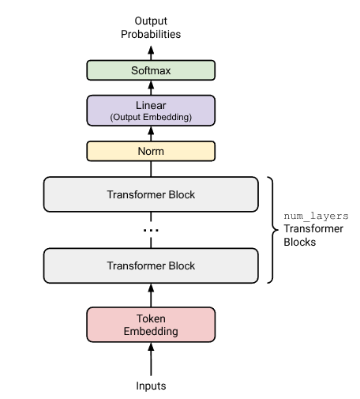
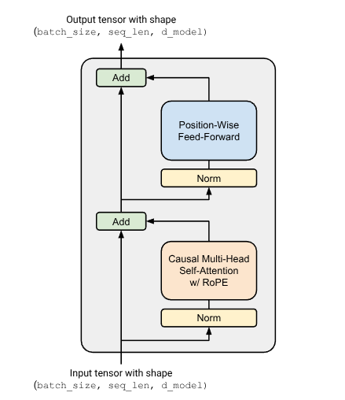
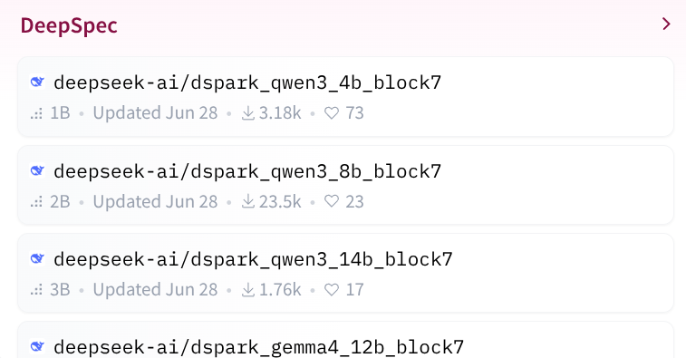

## Why to do?

感觉网上关于LLM的一些梳理要么太过"抽象"堆叠不够具体太过学术的公式,要么太多比喻让人实在难以感受到自己是否真正理解,所以在这里梳理一个足够"kiss"的基础  

## 简单概括

当下主流的大模型的几个标签:Transformer,Decoder-only,Autoregressive,Causal Attention,Pretraining,Post-training,Pre-Norm  

Transformer:基于注意力机制的神经网络架构,建模 Token 之间的依赖关系，提取上下文特征  
Decoder-only:仅使用 Transformer 解码器结构的模型架构,通过堆叠解码器层，构建适合自回归生成的语言模型  
Autoregressive:根据已有 Token，逐个预测并生成后续 Token  
Causal Attention:通过因果掩码，使每个 Token 只能关注自身及之前的 Token,防止训练时看到未来信息，保证自回归预测的因果性  
Pretraining:利用大规模数据进行基础训练，通常采用自监督学习,学习语言规律、知识表示和通用能力  
Post-training（后训练):在预训练模型基础上，通过 SFT、RL 等方法进一步训练,提升指令遵循、任务表现、推理及安全对齐能力  
Pre-Norm:现代主流LLM广泛采用的Transformer block 结构设计,一种归一层和残差连接的组织方式  

## Kiss model

这里我打算忽略一些哪怕极其常见的性能优化手段(大多是利用数学上的等价,也许),构建一个足够简单的理解  
os:感觉很多科普要么简单到本身原型就只选定了一层然后还要做很多抽象比喻,或者是严肃到简要提一嘴过程就开始重点解释各种数学公式,也可能是我理解错了吧......可能会提一嘴MoE,DSA什么的吧,这些也可以说是"事实标准"了吧,DeepSeek真牛逼......  

首先,给定一个token ID sequenceTransformer语言模型使用token嵌入层生成一个向量序列。(token嵌入层可训练)  
完成嵌入后,Activations会经过若干个结构相同的神经网络层进行处理。一个标准的Decoder-only Transformer语言模型由num_layers 个结构相同的层组成,即Transformer Blocks。
每个Transformer block都会执行两项主要操作：

- Self-Attention,聚合序列中不同位置的信息。
- Feed-Forward Layers,对这些信息进行非线性变换。

一个Transfoermer block的输入是Token Hidden States( \(X\) ),它来自Embedding或上一层Transformer Block。  

1.RMSNorm：归一化input Hidden States  
\[
[\operatorname{RMSNorm}(\mathbf{x})]_i =
\frac{x_i}{\sqrt{\frac{1}{d}\sum_{j=1}^{d}x_j^2 + \epsilon}}
\cdot g_i
\]

RMSNorm是现代LLM广泛使用的一种归一化方法,控制Token Hidden State的数值尺度,提高训练的稳定性。  

2.QKV Projection：生成Q、K、V  
已归一化的X_norm通过三个可训练的投影矩阵生成：
\[
\begin{aligned}
Q &= \hat{X} W_Q \\
K &= \hat{X} W_K \\
V &= \hat{X} W_V
\end{aligned}
\]
Query(Q):当前Token希望查询什么信息  
Key(K):用于与Query计算匹配程度  
Value(V):被Attention聚合的实际特征信息  

现在LLM大多是Multi-Head Attention,即让多个Attention Head并行地从不同的特征表示空间分析token之间的关系,再将各个Head的输出融合,形成新的Hidden States。  
标准MHA为每个Query Head配备独立的Key Head和Value Head,而GQA、MQA、MLA改变了K/V 的生成、共享或存储方式,主要目的是减少推理阶段的KV Cache开销。MHA、GQA、MQA的主要区别是K/V的共享范围,而MLA改变了K/V的表示与存储方式:  
MHA(Multi-Head Attention): 每个Query Head对应独立的K/V Head  
GQA(Grouped-Query Attention): 多个Query Heads分组共享K/V Heads  
MQA(Multi-Query Attention): 所有Query Heads共享一组K/V Heads  
MLA(Multi-Head Latent Attention): 利用低秩压缩,把多个Heads所需的K/V信息编码到一个共享的低维潜在向量中,从而减少KV Cache开销  
现代LLM通常还会使用RoPE(Rotary Position Embedding),对Q和K注入位置信息,让Attention能够感知Token之间的相对位置关系。  
3.Attention：聚合上下文信息  
这里就来到了来自那篇 Attention Is All You Need 的那条经典公式:
\[
\operatorname{softmax}\left(
\frac{QK^\top}{\sqrt{d_k}}
\right)V
\]
但是这里需要做一点小小的改变,也就是前面提到的在Decoder-only LLM的Causal Self-Attention中,还需要加入Causal Mask,这是为了确保每个token只能关注自己和之前的token。
具体就是在
\[
S = \frac{QK^\top}{\sqrt{d_k}}
\]
之后通过Mask将不允许关注的位置设置为负无穷。
改造之后的attention具体用公式表示出来就是:

\[
\operatorname{softmax}\left(
\frac{QK^\top}{\sqrt{d_k}}+M
\right)V
\]
其中\(M\)是因果掩码矩阵,对未来token的位置(可以当成向量对角线的右上边)填入\(-\infty\),使其Softmax权重为0。  
这里经常会用到FlashAttention(核心思想是通过Tiling和Online Softmax,减少HBM与片上SRAM 之间的数据传输,从而提高计算效率并降低显存占用。)
还有部分Transformer blcok会使用Linear Attention。  
4.Output Projection：融合多个Attention Heads  
假设每个token有32个Head的Attention Output,将它们拼接:
\[
O_{\text{concat}} = \operatorname{Concat}(O_1, \ldots, O_{32})
\]
接下来乘以可训练的输出投影矩阵 \(W_O\):
\[
O_{\text{proj}} = O_{\text{concat}} W_O
\]
5.Residual Add：第一次更新 Hidden States  
直接逐元素相加:
\[
H = X + O_{\text{proj}}
\]
将Attention聚合的上下文信息融合进该token当前的Hidden State。  
这里就是经常提到的残差连接(Residual Connection),核心作用就是缓解深层神经网络的梯度传播困难,使网络更容易训练,同时保留原始信息,实现特征的增量更新。
\[
y = x + F(x)
\]
6.RMSNorm：对更新后的 Hidden States 再次归一化  
\[
\hat{H} = \operatorname{RMSNorm}(H)
\]
这里使用的是另一个RMSNorm模块,通常有自己独立的可训练缩放参数。
7.FFN / MLP：对 Token 特征做非线性变换
这一阶段不再直接进行不同Token之间的Attention信息交互,而是分别处理每个token的特征向量。  
经典FFN:Hidden State → Linear(升维) → Activation(引入非线性) → Linear(降维) → MLP Output  
不过现代LLM常用SwiGLU(Swish-Gated Linear Unit): 双分支升维 → SiLU 激活与门控 → 逐元素相乘 → 降维  
这引入了一个独立的门控分支,让模型学习如何调节不同中间特征的贡献。
\[
\operatorname{SwiGLU}(x)=
\left[
\operatorname{SiLU}(xW_{\text{gate}})
\odot(xW_{\text{up}})
\right]W_{\text{down}}
\]
现在的大模型大都会使用MoE(Mixture of Experts),就是我们常说的混合专家模型,通常是一个独立的 FFN,可以采用SwiGLU等内部结构,不是真的是不同领域的"专家",哪怕涌现出了类似这种粒度情况的智能,那也不是刻意训练的结果。以前的FFN是Dense的,每个token都经过同一个FFN,使用该 FFN的全部参数,而MoE是spare的,每个token只经过被选中的 Expert FFN,而不是所有专家,具体是哪些专家则取决于token自身和Router。共享专家什么的,这里就不展开说了。
8.Residual Add：第二次更新 Hidden States  
将MLP产生的非线性特征变换结果融合到token已经更新过一次的Hidden State中。
\[
Y = H + F
\]
\(H\)：经过Self-Attention和第一次残差连接后,已经更新过一次的 Token Hidden States。  
\(F\)：将\(H\)经过RMSNorm和FFN(如SwiGLU)计算得到的非线性特征变换结果。  
这个Y就是当前Transformer block的最终输出,它会传入下一个Transformer block,成为下一层的input Hidden States。  

经过所有的Transformer block之后就是Final Norm:对最终的Hidden States进行RMSNorm,然后是Linear,将Hidden States 从d_model维映射到vocab_size维。最后则是Softmax(转换为概率分布),LM Head输出的Logits是任意实数,并不是概率,所以我们这样做:
\[
P_i = \frac{e^{z_i}}{\sum_{j=1}^{V} e^{z_j}}
\]
训练阶段:模型通常对所有序列位置输出 Logits,然后与对应的下一个Token ID计算Cross-Entropy Loss。实际实现中一般直接使用Logits 计算损失,不需要先显式执行Softmax。  
推理阶段:模型通常只需要最后一个有效token位置的Logits,经过必要的Logits处理和采样策略(如Greedy、Top-k、Top-p)选择下一个token,再继续生成。  
Prefill,Decode......先这样吧。  
DeepSeek甚至给Qwen做了一些投机解码模型,吼吼

