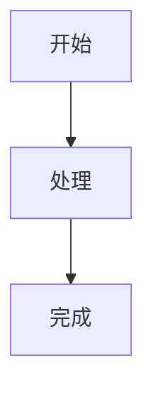

# 内容写作

## 新建与预览

在项目目录执行：

```bash
./scripts/new-post.sh understanding-transformers
./scripts/serve.sh -D
```

等价 Hugo 命令（需先 `source scripts/env.sh`）：

```bash
hugo new content --kind posts posts/understanding-transformers/index.md
```

文章必须放在 `content/posts/<bundle>/index.md`。脚本拒绝覆盖已有目录。新文章默认 `draft: true`；正文可以是中文或英文，无需配套翻译。开发预览只绑定回环地址，使用内存输出，默认阻止搜索引擎索引。

## Front Matter

```yaml
---
title: "Understanding Transformers"
slug: "understanding-transformers"
date: "2026-10-23"
description: "An introduction to Transformer architecture."
categories: ["技术研究"]
tags: ["Transformer", "Deep Learning"]
draft: true
---
```

必填字段不可省略。title/description 非空；slug 为小写英文、数字和连字符，必须全站唯一。categories 必须为数组且恰好一个：技术研究、工程实践、学习笔记、项目复盘、随笔。tags 为字符串数组，可为空。draft 必须为 YAML 布尔值，不能写成字符串 `"true"`。date 使用有效 ISO 日期或带时区的时间。

可选 `lastmod` 优先于 Git 最后提交时间，然后回退 date。`enableGitInfo: true` 要求仓库存在至少一个提交，本项目已初始化。新文章未被 Git 跟踪不影响日期回退。文章不允许使用 url/type/layout/outputs/build/publishDate 等绕过统一发布规范；新需求先调整校验器和测试。

## 草稿与公开发布

`draft: true` 仅控制 Hugo 输出，**不会阻止文件被 Git 提交**。不要暂存草稿及其私有图片/附件。Hook 会检查完整暂存快照，阻止草稿文章；它无法判断附件本身是否私密，需要人工审阅 `git diff --cached`。

`local-drafts/` 被 Git 忽略，且不属于 Hugo 内容目录，适合存放尚未整理的私密笔记。要预览其中一篇文章，手动复制到 `content/posts/<bundle>/`，保持 draft: true，然后 `serve.sh -D`。暂存前确认只包含准备公开的文件，完成后可移回本地目录。不要用忽略规则假装自动识别 Front Matter。

发布步骤：写完摘要和日期，将 draft 改为 false，运行以下检查，再仅暂存准备公开的文件。没有准备公开的文章时保留空站点即可。

```bash
./scripts/check-content.sh
./scripts/check-site.sh
git add content/posts/understanding-transformers
./scripts/check-precommit.sh
git diff --cached
git commit -m "Publish transformer article"
```

未来设置真实 GitHub 远程后才人工推送；本次不操作远程。

## 图片、封面与附件

图片与附件和 index.md 放在同一 Bundle。Markdown 使用 ``、`[下载 PDF](attachment.pdf)`。全局素材才放 static/images/site。内部文章使用 `/posts/<slug>/`，不要写源文件系统路径。图片应有有意义的替代文字，附件不要包含私密数据。

可选封面：

```yaml
cover:
  image: "cover.webp"
  alt: "Transformer architecture diagram"
  relative: true
```

推荐 16:9、约 1200×675、WebP。没有封面时直接省略 cover；主题不会创建空区域或占位图。有封面时在列表、正文和社交元信息使用同一资源，已在隔离构建中验证。不要给不存在的图片写配置。

## 技术内容

代码围栏填写 python、go、bash、json 等语言标记，由 Chroma 高亮。复制按钮由 PaperMod 提供。默认无行号，可使用 `` ```go {linenos=true,hl_lines=[3]} `` 开启指定块的行号并高亮第 3 行。长行可横向滚动。

数学公式在 Front Matter 加 `math: true`，然后写 `\(E=mc^2\)`、`\[...\]` 或 `$$...$$`。不要给普通文章开数学开关。Passthrough 保留数学反斜杠；代码围栏和反引号中的内容仍按代码处理。KaTeX 需要访问固定版本 CDN。

图表使用真正的 mermaid 围栏，不需要另加页面参数：

````markdown

````

源码会经过 HTML 转义，Mermaid 用 strict 安全模式渲染，随主题切换重绘。普通代码块不受影响。浏览器需要访问固定版本 Mermaid CDN；语法错误时显示提示。

目录默认折叠，仅展示 H2/H3。避免用 H1 再写一遍文章标题。

## 固定 URL 与 aliases

slug 决定 `/posts/:slug/`，日期和分类变化不影响 URL。修改 slug 时添加旧路径：

```yaml
slug: "new-slug"
aliases: ["/posts/old-slug/"]
```

aliases 必须是站内绝对路径，不允许协议、查询参数、片段或路径穿越；不能覆盖系统导航或其他文章路径。Hugo 生成静态跳转页面，验证器检查冲突。aliases 不等于服务器 HTTP 301，永久 HTTP 状态跳转如有需要另行维护 Nginx。

## 示例、个人资料与授权

`examples/basic-post` 和 `examples/technical-post` 演示完整写法；它们默认 draft:true，自动测试复制到临时站点后再改为 false，从不进入正式 content。复制作为新文章时必须修改标题、slug、摘要、分类、日期及内链，不直接发布演示。

首页简介改 hugo.yaml 的 homeInfoParams；网站名称改 title 与 params.label.text；关于页改 content/about.md；社交链接改 socialIcons，未知地址不要渲染。RSS 地址已经有效。Cloudflare 配置见部署文档。

已明确授权的原创文章采用 CC BY-NC-SA 4.0：署名、非商业、按规定相同或兼容许可分享改编，第三方素材另遵守各自许可。Logo 和头像不自动纳入此许可，详见 [LICENSE-CONTENT.md](../LICENSE-CONTENT.md)。
