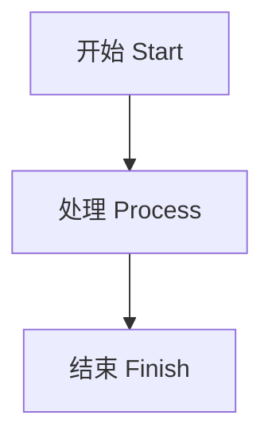

## 代码

```python
print("中文搜索 / transformer")
```

```go {linenos=true,hl_lines=[3]}
package main
import "fmt"
func main() { fmt.Println("hello") }
```

```bash
printf '%s\n' 'hello'
```

```json
{"name": "blog", "published": false}
```

## 数学

行内公式 \(E = mc^2\)。

\[
\sum_{i=1}^{n} i = \frac{n(n+1)}{2}
\]

$$
\int_0^1 x^2\,dx = \frac{1}{3}
$$

普通反斜杠：`C:\\work`。转义星号：\*不是强调\*。

## 图表



### 附件和链接


[下载示例数据](data.csv) · [基础文章](/posts/example-basic-post/)

FULL_RSS_SENTINEL：这段文字位于正文末尾，用于检查 RSS 是否包含完整正文。
